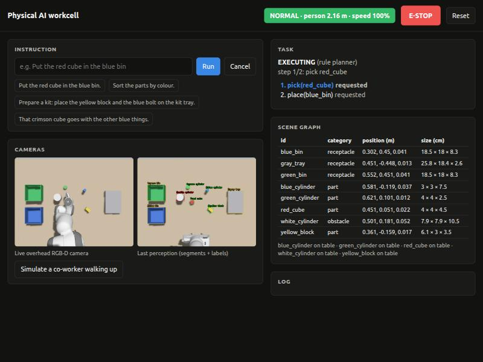

# Physical AI Workcell

**Instruction → perception → plan → safe execution → verification**, as one closed loop on
ROS 2 Humble, Gazebo Fortress and MoveIt 2, with a Franka Panda arm and an overhead RGB-D camera.

Type *"Prepare a kit: place the yellow block and the blue bolt on the kit tray"*. The cell:
1. finds the parts with its camera (no trained detector, so unseen objects work too);
2. plans the moves with Claude;
3. executes them collision-free;
4. checks with the camera that each part really arrived;
5. re-plans if anything went wrong or was moved;
6. slows or stops whenever a person comes close.



**Benchmark** (76 randomised trials, scored on simulator ground truth; details in [docs/RESULTS.md](docs/RESULTS.md)):

| | AI pipeline (offline planner) | Traditional taught cell |
|---|---|---|
| Taught (nominal) layout | 100% | 100% |
| Random positions / lighting / clutter / mid-task disturbance | 96% (23/24) | 0% |
| Unseen objects & paraphrased instructions | 38% (3/8)* | 0% |
| **Overall** | **84%** | **16%** |
| Reported success with a wrong end state | 0 | 0 |

\* The 4 paraphrased instructions need the Claude planner (no API key was available for this run).
The offline planner asked for clarification instead of guessing, and did not move.


| Document | Contents |
|---|---|
| [docs/TECHNICAL_REPORT.md](docs/TECHNICAL_REPORT.md) | architecture, models, perception-to-action workflow, data & training approach, safety, limitations, scaling |
| [docs/RESULTS.md](docs/RESULTS.md) | benchmark: AI pipeline vs. a traditional taught cell (generated) |

---

## 1. Setup

Tested on Ubuntu 22.04, ROS 2 Humble, Gazebo Fortress, 8 CPU cores, 7 GB RAM, no NVIDIA GPU.

```bash
sudo apt install ros-humble-moveit ros-humble-ros-gz ros-humble-gz-ros2-control \
  ros-humble-ros2-controllers ros-humble-moveit-resources-panda-description \
  ros-humble-moveit-resources-panda-moveit-config
pip install --user anthropic          # Claude planner (optional; offline planner otherwise)
```

**Claude API key** (optional, needed for free-form language): create one at
https://console.anthropic.com, then store it without it appearing on screen:

```bash
mkdir -p ~/.config/pai && read -s -p "Anthropic API key: " k && echo "$k" > ~/.config/pai/anthropic_api_key && chmod 600 ~/.config/pai/anthropic_api_key && unset k
```

The planner uses `ANTHROPIC_API_KEY` if set, otherwise that file. Without a key the system runs on
the offline rule planner, and the log says so.

**Build:**

```bash
cd physical_ai_ws
source /opt/ros/humble/setup.bash
colcon build --symlink-install
source install/setup.bash
```

## 2. Run the demo

```bash
ros2 launch pai_bringup bringup.launch.py
```

This one command starts Gazebo (GUI), RViz with the MoveIt panel, and the whole pipeline. Open
**http://localhost:8080** for the operator console: type an instruction or click an example, watch
the plan and scene graph update, press **E-STOP**, or **simulate a co-worker walking up**.

From a terminal instead:

```bash
ros2 run pai_planner run_instruction "Put the red cube in the blue bin"
```

To see the plan without moving, add `--dry-run`.

Useful launch arguments:

| argument | default | meaning |
|---|---|---|
| `headless` | `false` | no Gazebo GUI (saves RAM) |
| `rviz` | `true` | RViz + MoveIt panel |
| `gui_panels` | `false` | show Gazebo's side panels (World inspector, Entity Tree) |
| `planner` | `auto` | `auto` (Claude if a key is available) / `claude` / `rule` |
| `perception_backend` | `geometric` | `claude` adds Claude-vision object names ("coffee mug") |
| `scene` | `scene_default.yaml` | any scene YAML; the world is generated from it at launch |

Switch planners while running: `ros2 param set /executor planner rule`.

## 3. Tests and benchmark

Run each test against a running bringup (`headless:=true rviz:=false` is fine):

| command | checks |
|---|---|
| `ros2 run pai_bringup phase1_check.py` | robot, controllers, camera calibration, MoveIt motion, gripper |
| `ros2 run pai_skills skills_check` (launch with `perception:=false executor:=false`) | real pick & place of 3 parts (Gazebo ground truth), refusal of an oversized object |
| `ros2 run pai_perception perception_check` | every object found with the right colour/shape/category, position error, unseen objects, dim lighting, stable ids |
| `ros2 run pai_benchmark system_check` | instruction → end state, mid-task disturbance → re-plan, ambiguity → question, person nearby → SLOW/STOP/resume, e-stop |
| `PYTEST_DISABLE_PLUGIN_AUTOLOAD=1 python3 -m pytest src/pai_planner/test` | planner parsing, validator, Claude repair loop (offline) |

Benchmark (AI pipeline vs. rule-based baseline, randomised scenes, scored on ground truth):

```bash
scripts/run_benchmark.sh                                  # offline AI pipeline + traditional cell, 2 trials each
```

That starts a headless simulator, runs the trials, writes `docs/RESULTS.md` plus charts, and shuts down
(about 80 minutes). To add the Claude planner once your API key is set (about 40 minutes):

```bash
scripts/run_benchmark.sh --systems claude --trials 2
```

Results are appended to `docs/benchmark.csv` and the report covers everything in it.

Conditions: `nominal`, `pose` (random positions/orientations), `lighting`, `clutter` (distractors +
moved obstacle), `disturbance` (part moved mid-task), `novel` (unseen objects + paraphrased
instructions).

## 4. What's inside

```
src/
  pai_description    Panda for Gazebo (meshes, inertials, ros2_control, TCP, sim grasp joints)
  pai_moveit_config  MoveIt 2 config
  pai_bringup        scene YAML -> world generator, controllers, the one launch file, RViz
  pai_interfaces     msgs: DetectedObject, SceneGraph, SafetyStatus, TaskStatus
                     actions: Pick, Place, MoveTo, RunInstruction
  pai_core           shared: geometry, scene graph, planning-scene sync, Claude client, sim control
  pai_perception     class-agnostic RGB-D segmentation (+ optional Claude vision labels)
  pai_world_model    tracking, relations, held object, MoveIt planning-scene sync
  pai_skills         pick / place / move_to on MoveIt 2, safety-aware, self-correcting
  pai_planner        Claude + rule planners, plan validator, closed-loop executor, CLI
  pai_safety         speed & separation monitoring, e-stop, watchdog; simulated co-worker
  pai_ui             browser operator console
  pai_benchmark      system tests, traditional baseline cell, benchmark, report
```

## 5. Conventions and honest notes

- The `world` frame is the robot base; the table top is at z = 0. The scene YAML is also the
  benchmark's ground-truth reference.
- **Simulated grasp.** Finger-contact physics in Gazebo squeezes small parts out, so once a part
  is confirmed between the fingers it is welded to the hand (DetachableJoint). The real-gripper
  code path (close until stall, check width) is kept for hardware.
- **Simulated person sensor.** `human_sim` publishes the mannequin's position like a safety laser
  scanner would.
- **Bins.** Parts deep inside an 8 cm bin can't be picked top-down with the Panda hand (it hits the
  walls). The skill refuses with an explanation rather than trying.
- **Not safety-certified.** This is a software safety layer for a prototype; see the technical
  report, §6.

## 6. More documentation

- [`docs/PROJECT_KNOWLEDGE_BASE.md`](docs/PROJECT_KNOWLEDGE_BASE.md) ([PDF](docs/PROJECT_KNOWLEDGE_BASE.pdf)): the whole project in one file, from beginner level to every parameter
- [`docs/TECHNICAL_REPORT.md`](docs/TECHNICAL_REPORT.md): architecture, safety, limitations, scalability
- [`docs/RESULTS.md`](docs/RESULTS.md): benchmark results
- [`hardware/HARDWARE.md`](hardware/HARDWARE.md): building the real SO-101 version

## License

MIT, see [LICENSE](LICENSE). The SO-101 design files in `hardware/SO-ARM100/` are by TheRobotStudio
under Apache-2.0 (see the licence in that folder).
