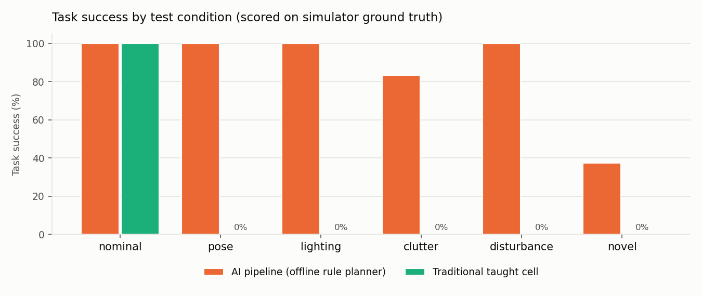
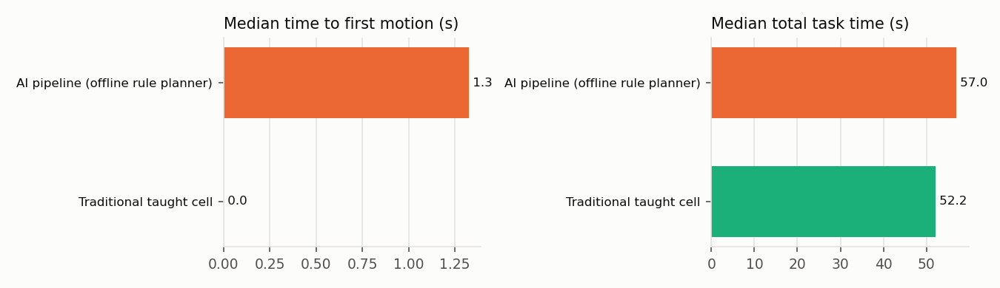

# Benchmark results

76 trials. A trial succeeds only if every goal holds in Gazebo afterwards and no other part was moved by more than 3 cm.

## Success rate by condition

| condition | AI pipeline (offline rule planner) | Traditional taught cell |
|---|---|---|
| nominal | 100% (6/6) | 100% (6/6) |
| pose | 100% (6/6) | 0% (0/6) |
| lighting | 100% (6/6) | 0% (0/6) |
| clutter | 83% (5/6) | 0% (0/6) |
| disturbance | 100% (6/6) | 0% (0/6) |
| novel | 38% (3/8) | 0% (0/8) |
| **all** | **84%** (32/38) | **16%** (6/38) |

## Other metrics (all trials)

| metric | AI pipeline (offline rule planner) | Traditional taught cell |
|---|---|---|
| goals achieved | 85% | 16% |
| reported success but wrong end state | 0 | 0 |
| other parts disturbed | 0 | 1 |
| asked for clarification | 4 | 0 |
| median planning time (s) | 0.00 | 0.00 |
| median time to first motion (s) | 1.3 | 0.0 |
| median total time, successful (s) | 57 | 52 |
| trials that re-planned | 9 | 0 |
| safety stops | 0 | 0 |

## Failures

- `rule` / clutter / kit #0: FAILED: giving up after 3 re-plans; last error: descending to grasp: straight-line path blocked (76% feasible)
- `rule` / novel / novel_object #1: FAILED: giving up after 3 re-plans; last error: descending to grasp: straight-line path blocked (97% feasible)
- `rule` / novel / paraphrase #0: NEEDS_CLARIFICATION: I could not work out which part should go where. Please say e.g. "put the red cube in the blue bin".
- `rule` / novel / paraphrase #1: NEEDS_CLARIFICATION: I could not work out which part should go where. Please say e.g. "put the red cube in the blue bin".
- `rule` / novel / paraphrase_kit #0: NEEDS_CLARIFICATION: There are 2 cylinders (blue_cylinder_2, green_cylinder). Which one?
- `rule` / novel / paraphrase_kit #1: NEEDS_CLARIFICATION: There are 2 cylinders (blue_cylinder, green_cylinder_2). Which one?
- `baseline` / pose / single #0: P1 red cube to blue bin: stopped: descending to grasp: straight-line path blocked (55% feasible)
- `baseline` / pose / single #1: P1 red cube to blue bin: stopped: grasp missed: no part between the fingers at the expected position of taught_part
- `baseline` / pose / sort #0: P2 sort by colour: stopped: grasp missed: no part between the fingers at the expected position of taught_part
- `baseline` / pose / sort #1: P2 sort by colour: stopped: grasp missed: no part between the fingers at the expected position of taught_part
- `baseline` / pose / kit #0: P3 build kit: stopped: descending to grasp: straight-line path blocked (69% feasible)
- `baseline` / pose / kit #1: P3 build kit: stopped: grasp missed: no part between the fingers at the expected position of taught_part
- `baseline` / lighting / single #0: P1 red cube to blue bin: stopped: grasp missed: no part between the fingers at the expected position of taught_part
- `baseline` / lighting / single #1: P1 red cube to blue bin: stopped: descending to grasp: straight-line path blocked (76% feasible)
- `baseline` / lighting / sort #0: P2 sort by colour: stopped: grasp missed: no part between the fingers at the expected position of taught_part
- `baseline` / lighting / sort #1: P2 sort by colour: stopped: grasp missed: no part between the fingers at the expected position of green_cylinder
- `baseline` / lighting / kit #0: P3 build kit: stopped: descending to grasp: straight-line path blocked (77% feasible)
- `baseline` / lighting / kit #1: P3 build kit: stopped: grasp missed: no part between the fingers at the expected position of taught_part
- `baseline` / clutter / single #0: P1 red cube to blue bin: stopped: moving above part: the arm did not reach the target (blocked?)
- `baseline` / clutter / single #1: P1 red cube to blue bin: stopped: grasp missed: no part between the fingers at the expected position of taught_part
- `baseline` / clutter / sort #0: P2 sort by colour: stopped: grasp missed: no part between the fingers at the expected position of taught_part
- `baseline` / clutter / sort #1: P2 sort by colour: stopped: grasp missed: no part between the fingers at the expected position of taught_part
- `baseline` / clutter / kit #0: P3 build kit: stopped: descending to grasp: straight-line path blocked (97% feasible)
- `baseline` / clutter / kit #1: P3 build kit: stopped: grasp missed: no part between the fingers at the expected position of taught_part
- `baseline` / disturbance / single #0: P1 red cube to blue bin: stopped: grasp missed: no part between the fingers at the expected position of taught_part
- `baseline` / disturbance / single #1: P1 red cube to blue bin: stopped: grasp missed: no part between the fingers at the expected position of taught_part
- `baseline` / disturbance / sort #0: P2 sort by colour: stopped: grasp missed: no part between the fingers at the expected position of taught_part
- `baseline` / disturbance / sort #1: P2 sort by colour: stopped: grasp missed: no part between the fingers at the expected position of taught_part
- `baseline` / disturbance / kit #0: P3 build kit: stopped: grasp missed: no part between the fingers at the expected position of taught_part
- `baseline` / disturbance / kit #1: P3 build kit: stopped: grasp missed: no part between the fingers at the expected position of taught_part
- `baseline` / novel / novel_object #0: FAILED: no taught program matches this instruction
- `baseline` / novel / novel_object #1: FAILED: no taught program matches this instruction
- `baseline` / novel / novel_pair #0: FAILED: no taught program matches this instruction
- `baseline` / novel / novel_pair #1: FAILED: no taught program matches this instruction
- `baseline` / novel / paraphrase #0: FAILED: no taught program matches this instruction
- `baseline` / novel / paraphrase #1: FAILED: no taught program matches this instruction
- `baseline` / novel / paraphrase_kit #0: P3 build kit: stopped: descending to grasp: straight-line path blocked (74% feasible)
- `baseline` / novel / paraphrase_kit #1: P3 build kit: stopped: grasp missed: no part between the fingers at the expected position of taught_part
